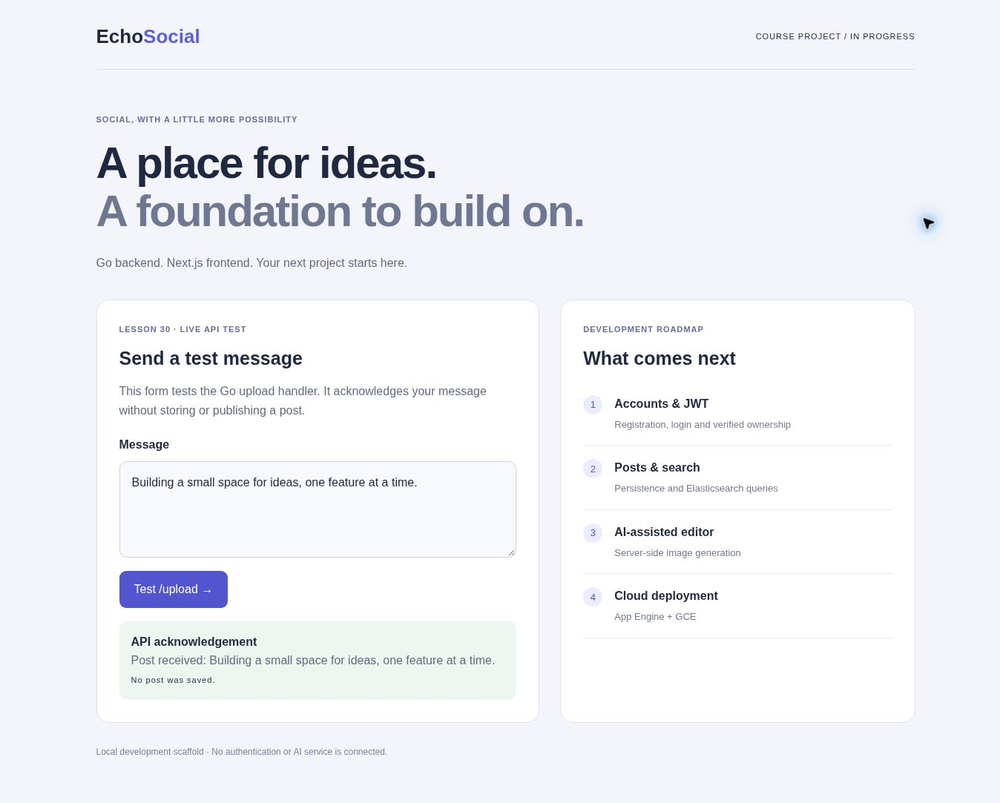
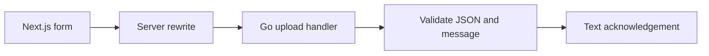

# EchoSocial

### A typed web client meets a Go API

An AI social-network project starting with a working client-to-server message flow. Compose a message in Next.js, submit it to the Go handler, and inspect the server acknowledgement.

**Go · Gorilla Mux · Next.js · React · TypeScript · Tailwind CSS**

[Run locally](#run-locally) · [Architecture details](docs/ARCHITECTURE.md) · [Development roadmap](docs/NEXT_STEPS.md)



*Actual browser capture after a successful request to the running Go API. The message is acknowledged, not stored or published.*

## Engineering highlights

- A Next.js form exercises the Go API through a server-side rewrite.
- The handler bounds request size, rejects malformed JSON and validates message length.
- Handler tests cover input validation and response behavior.
- The project separates frontend, HTTP handlers and the post model for future persistence and authentication.

## Architecture



## Current scope

| Working local demo | Next milestones |
| --- | --- |
| Message form and upload acknowledgement | Persistent posts and ownership |
| Bounded JSON parsing and handler tests | Signup and JWT login |
| No credentials required | Elasticsearch search and AI image generation |

**Status: runnable API scaffold, in active development.** The upload endpoint does not save posts, upload files or generate images. The course implementation currently reaches Go Handlers (Lesson 30). [Screenshot reproduction](docs/SHOWCASE.md).

## Run locally

Prerequisites: Go 1.25+, Node 22.12+, npm.

```sh
cd backend
go mod download
go test ./...
go run .
```

In another terminal:

```sh
cd frontend
npm ci
npm run dev
```

Open http://localhost:3000. `/backend/upload` is proxied server-side to Go at `http://127.0.0.1:8080/upload`. If MealRoute is running on port 8080, stop it first or change Go's `LISTEN_ADDR` and the frontend `NETWORKAI_BACKEND_URL` together.

```sh
curl -X POST http://127.0.0.1:8080/upload -H 'Content-Type: application/json' -d '{"id":"demo-1","user":"demo","message":"Hello EchoSocial","url":"","type":"image"}'
```

Expected: `Post received: Hello EchoSocial`. No database write occurs.

See [development roadmap](docs/NEXT_STEPS.md), [course mapping](docs/COURSE_MAP.md) and [architecture](docs/ARCHITECTURE.md).
